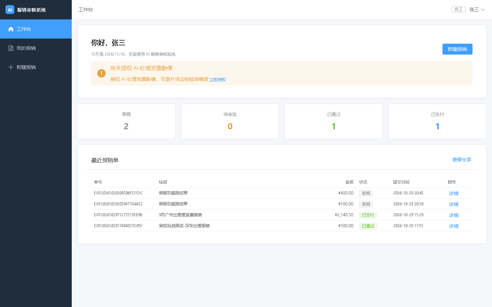
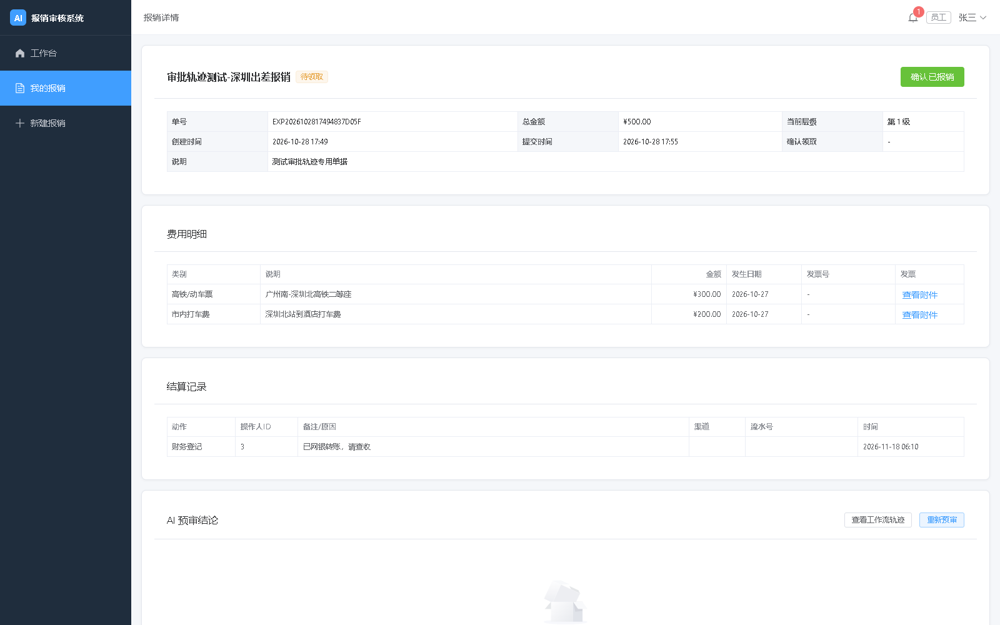
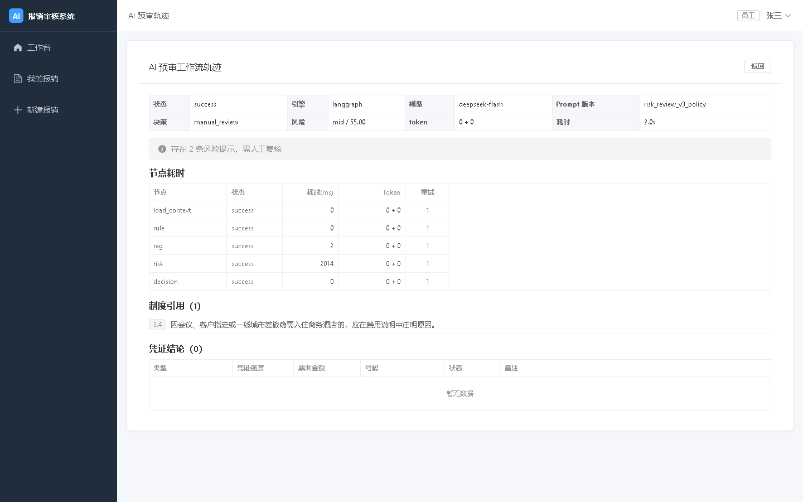
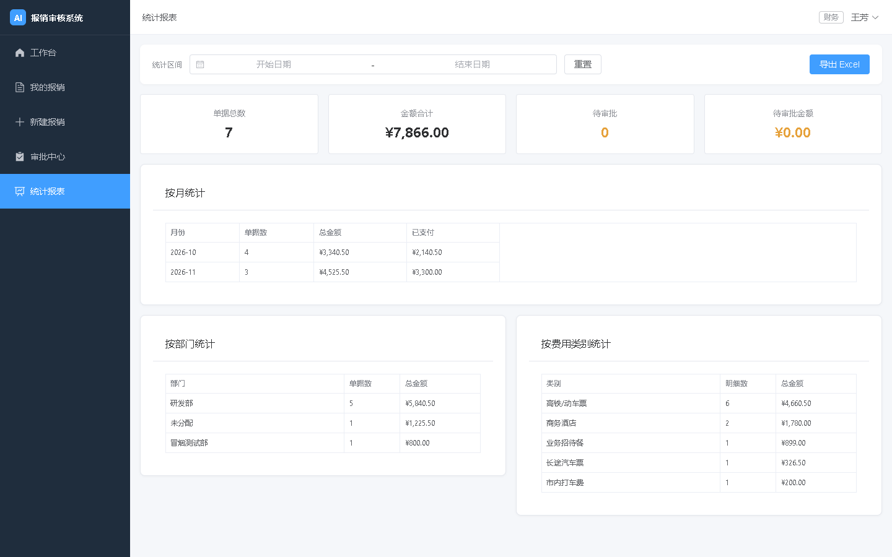
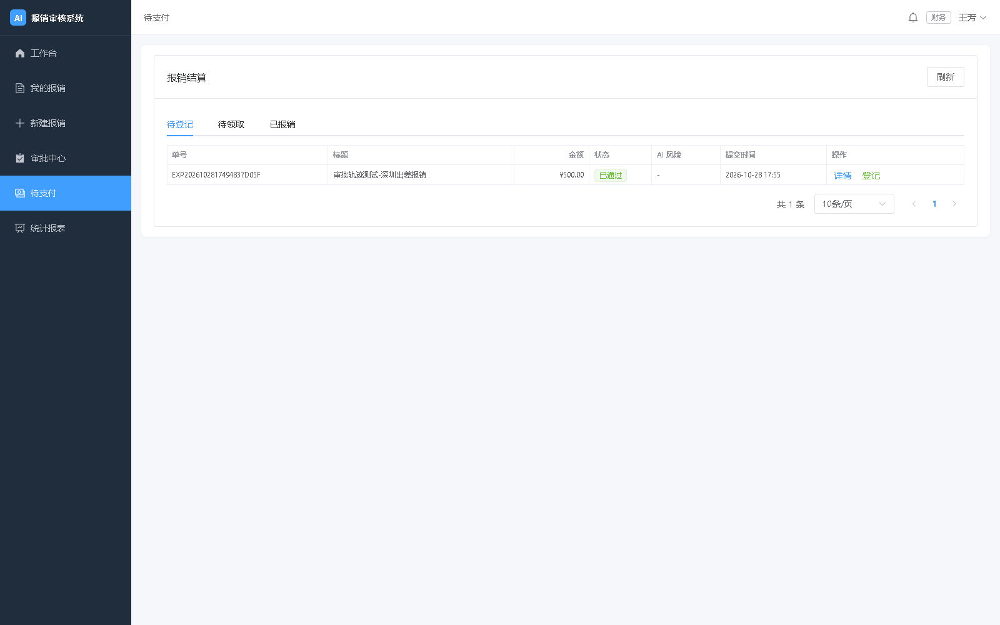
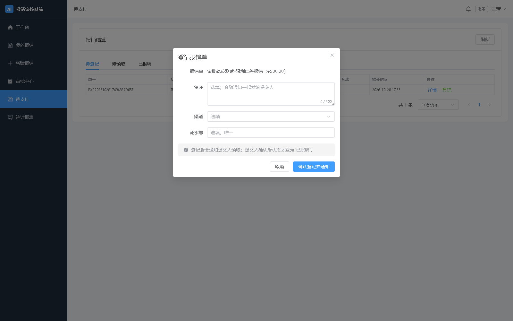
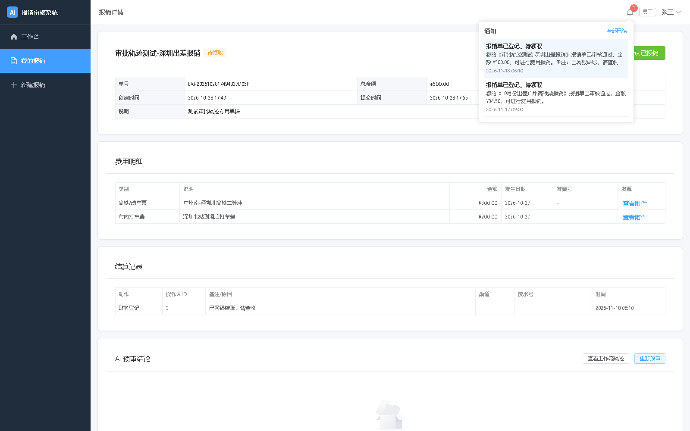

# AI Agent 财务报销审核系统

[](https://github.com/im1530/expense-audit-system/actions/workflows/ci.yml)

一个**可运行**的报销审核平台：Vue 3 前端 + FastAPI 后端，核心是把「制度条款」变成可检索、可引用的依据，把「规则」变成确定性结论，再让 LLM 补充规则覆盖不到的疑点。
**AI 只出建议、人工做决定；AI 失败自动降级为规则结论，绝不阻断审批。**

- 后端 79 个 REST 接口 · 486 个离线单测
- 前端 13 个页面（含 4 个管理端）· 30 个单测
- 制度检索核心条款覆盖 82.4% → **100%**（68 条评测案例，离线可复现）
- 96 条标注集：决策一致率 100%、风险等级 100%、高危漏放 0
- 两阶段结算：财务登记 → 提交人确认领取，站内通知，制度 v1.3

## 它解决什么问题

传统报销靠人眼看票、凭经验判断，三个痛点：制度记不住、票据核不完、结论说不清。
这个项目把它们拆成三段可验证的链路：

1. **规则引擎**（确定性）：限额、缺票、重复、跨期，命中即给证据；
2. **制度 RAG**（可解释）：把制度拆成 33 条条款，检索后要求模型**逐字引用原文**；
3. **LLM 预审**（补位）：只补充规则覆盖不到的疑点，结论带风险分、等级与建议决策。

## 架构

```
浏览器
  │  静态资源 + /api 反代
  ▼
Nginx ──────────────► FastAPI（uvicorn，单 worker）
                        │        │
                        │        └── MySQL（业务 + 审计 + LangGraph 检查点）
                        └─────────── Redis（Celery 队列 / 限流共享计数）
                              │
                              ▼
                    Celery worker ──► AI 预审链路
                                       document（凭证识别）
                                         → rule（规则）
                                         → rag（制度检索）
                                         → risk（LLM + 引用校验）
                                         → decision（确定性决策）
```

## 五分钟跑起来

前置：Python 3.13、MySQL 5.7+、Node 18+（只跑后端可不要 Node）。

```bash
# 1) 前端构建（产物给 Nginx 或 vite preview）
cd frontend && npm ci && npm run build

# 2) 后端依赖与数据库
cd ../backend
python -m venv .venv && .venv/Scripts/pip install -r requirements.txt
mysql -uroot -p < app/sql/schema.sql
mysql -uroot -p < app/sql/init_data.sql

# 3) 配置：复制 .env.example 为 .env，至少填 DATABASE_URL 与 SECRET_KEY
#    DEEPSEEK_API_KEY 可以不填 —— AI 预审会自动降级为规则结论，功能仍完整

# 4) 启动
.venv/Scripts/python.exe -m uvicorn app.main:app --host 127.0.0.1 --port 8000
```

- 接口文档：`http://127.0.0.1:8000/api/docs`
- 初始账号：`admin / Admin@123456`，**首次登录强制改密**
- 本地演示账号：执行 `python scripts/seed_demo_passwords.py` 后，`testuser / manager1 / fin1 / manager2 / emp_p2 / fin2` 的密码统一为 `Demo@123456`（**仅本地演示，生产必须停用**）
- 不填 Key 时：`AI 预审 = 规则兜底`（`is_fallback=true`），报表/审批/凭证上传全部照常

> 部署（Nginx / systemd / 内网自签 HTTPS / 数据库最小权限）见 [`docs/DEPLOYMENT.md`](docs/DEPLOYMENT.md)。

## Docker 一键体验（推荐给第一次跑的人）

不装 Python/MySQL/Redis，直接：

```bash
export DEEPSEEK_API_KEY=sk-xxxx     # 可选；不配则 AI 预审自动降级为规则
docker compose up --build
```

- 打开 <http://localhost:8080>，`admin / Admin@123456`（首次登录强制改密）；
- 演示账号（testuser/manager1/fin1，密码 `Demo@123456`）需先执行：
  `docker compose exec backend python scripts/seed_demo_passwords.py`
- 详细说明与和生产环境的差异见 [`docs/DOCKER.md`](docs/DOCKER.md)。

## 四个值得看的设计

| 设计 | 做法 | 为什么 |
|---|---|---|
| **规则优先，LLM 只补位** | `rule_hits` 是确定性结论；命中 `block` 时最终等级强制 high，模型不能改写规则等级，也不允许重复描述规则已覆盖的风险 | 避免模型"自由发挥"把确定性结论说轻 |
| **引用必须逐字可查** | 只允许引用**本轮检索到**的条款；`quote` 必须是原文**连续片段**（只忽略空白/全半角），否则丢弃并记审计 | 杜绝"依据第 X 条"式的编造引用 |
| **AI 失败不阻断业务** | 超时 / JSON 非法 / 超预算 / 工作流异常 → 降级为规则兜底，`is_fallback=true`，前端明确提示 | 报销不能被模型可用性卡住 |
| **企业级约束** | 任务幂等（同单唯一进行中）、`UPDATE ... WHERE status='pending'` 原子领取、状态与审批记录同事务、全程审计表、`raw_response` 默认不落库 | 并发、可追溯、数据最小化 |

还有两处刻意的取舍：

- **单 worker**：Chroma 本地持久化（SQLite + 文件锁）不支持多进程并发写，多 worker 会在启动时并发重建集合；
- **引用指标有噪声**：同一 Prompt、`temperature=0` 重跑 11 条，仅 6/11 一致（±5pp），所以文档只把"检索覆盖率 100%"当稳定指标，版本优劣需要多次取中位数。

## 测试与评测

```bash
cd backend
.venv/Scripts/python.exe -m unittest discover -s tests          # 486 个，离线
cd ../frontend && npm test                                      # 30 个，jsdom
```

- 后端测试**不联网、不调真实 LLM**：LLM 用假客户端/录制回放，Chroma 用假 embedding + 内存 client；
- 使用独立测试库 `expense_audit_test`，用例前清表、灌最小种子数据，进程退出删除；
- 真实模型评测：`scripts/evaluate.py --mode real`（会产生费用），指标口径与历史结论见 [`backend/evaluation/README.md`](backend/evaluation/README.md)。

## 真实数据验证（自采集，2026-11-15）

除合成集外，还用本人 10 笔真实消费凭证（脱敏）做了补充验证：

- **票据真实、事由构造、模拟公司抬头**，不是公司真实报销；原始图片/PDF 不进仓库；
- OCR 10 条：类型/金额/日期/商户 **40/40**；交通票日期口径问题已通过 Prompt v2 修复；
- 风险链路：票面 34.50 vs 明细 1200 → `high / suggest_reject`，document → rule → risk → decision 联动正常；
- 审批链路：测试库全链路 + 生产入口（443）两级审批均通过；结算链路在测试库/Docker 已验证“登记 → 提交人确认”；
- 独立双标：60 条盲标 κ=0.9495（95%CI 0.8705–1.0000），2 条分歧已裁决；
- 详见 `backend/evaluation/reports/`（`real_self_v1_*`、`blind_v2_*`、`e2e_smoke_20261115.md`）。

> 这批“真实数据”只用于离线评测与冒烟，不参与线上预审，也不用于调 Prompt。

## 目录结构

```
expense-audit-system/
├── backend/          # FastAPI：路由/服务/模型/Agent/工作流/RAG（逐文件说明见 backend/README.md）
├── frontend/         # Vue 3 + Element Plus + Pinia（见 frontend/README.md）
├── deploy/           # Nginx 样例、systemd、部署自检、自签证书生成
├── docs/             # 部署、上线清单、制度原文、引用漏引方案
└── LICENSE           # MIT
```

## 文档

| 文档 | 内容 |
|---|---|
| [`backend/README.md`](backend/README.md) | 后端逐文件职责、分层约定、三条硬约束 |
| [`docs/DOCKER.md`](docs/DOCKER.md) | Docker 一键体验、演示账号、与生产差异 |
| [`frontend/README.md`](frontend/README.md) | 前端目录、与后端的约定（登录表单、金额字符串、角色菜单） |
| [`docs/DEPLOYMENT.md`](docs/DEPLOYMENT.md) | 部署步骤、内网自签 HTTPS、最小权限账号、常见坑 |
| [`docs/GO_LIVE_CHECKLIST.md`](docs/GO_LIVE_CHECKLIST.md) | 上线前逐项检查（P0/P1）与已知边界 |
| [`docs/CITATION_RECALL_PLAN.md`](docs/CITATION_RECALL_PLAN.md) | 引用漏引的定位过程与收口方案 |
| [`docs/policies/expense_policy_v1_3.md`](docs/policies/expense_policy_v1_3.md) | 制度原文（v1.3，33 条；v1.2 保留在 `expense_policy_v1.md` 仅用于 blind_v2 冻结复现） |

## 界面截图

| 工作台 | 报销详情 |
|---|---|
|  |  |

| 工作流轨迹 | 统计报表 |
|---|---|
|  |  |

### 两阶段结算（财务登记 → 提交人确认领取）

| 报销结算 | 财务登记 | 站内通知 |
|---|---|---|
|  |  |  |


## 状态与边界

- 这是个人项目，用于展示完整的工程实现；演示数据均为虚构（姓名/手机号已脱敏）。
- 没有企业真实报销数据；用本人 10 笔脱敏消费凭证做了补充验证（`real_self_v1`），但它属于个人自采集样本，不代表企业生产分布；
- 60 条独立双标（blind_v2）已完成：风险等级 κ=0.9495（95%CI 0.8705–1.0000）、58/60 一致、2 条分歧已裁决；定位为**人工标准基准**（不直接作为系统评测金标准），旧高危 24 条仅作抽样框；

## License

[MIT](LICENSE)
